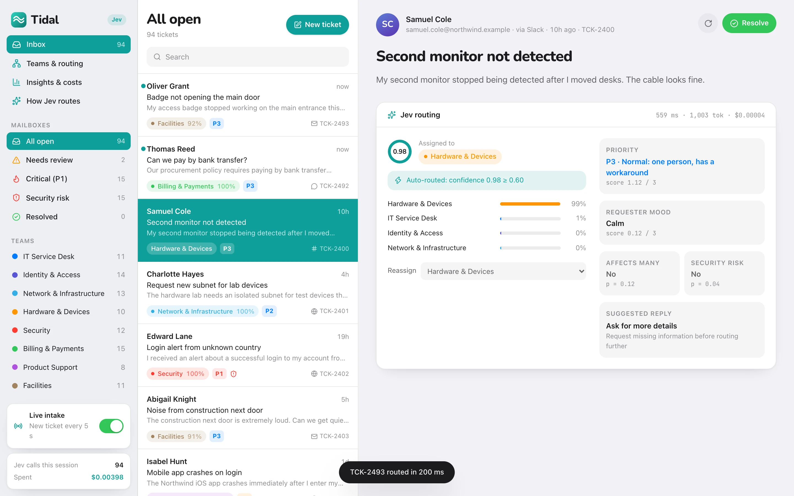
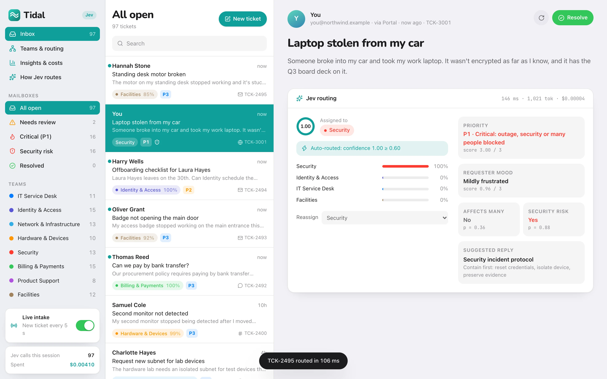
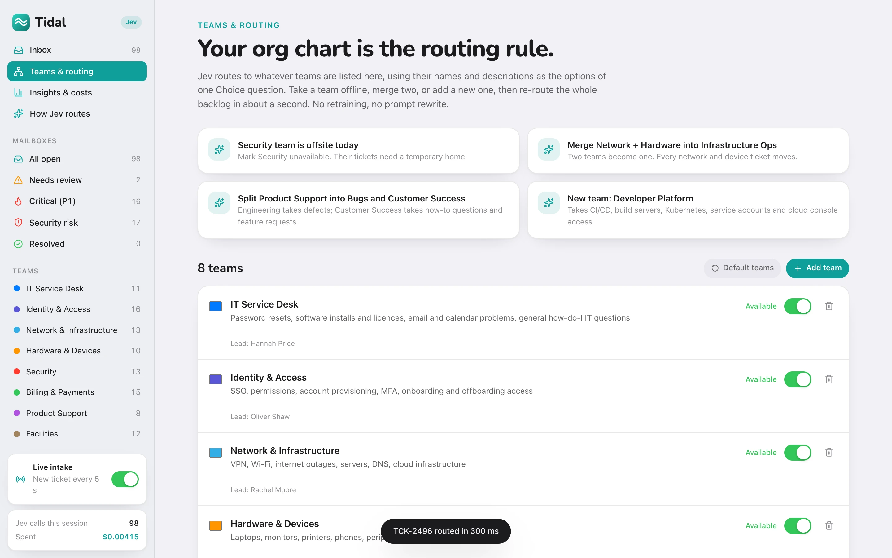
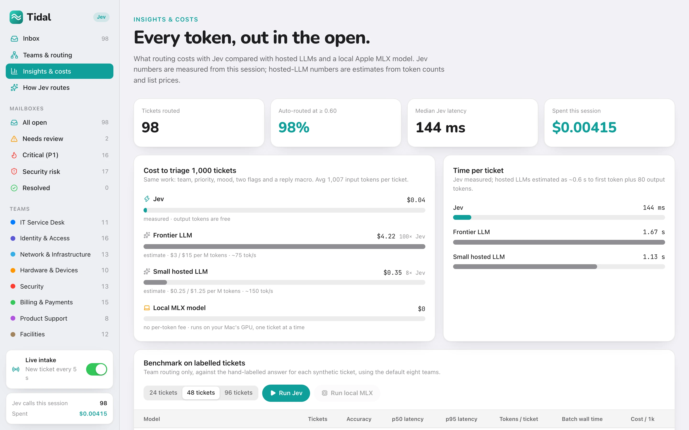
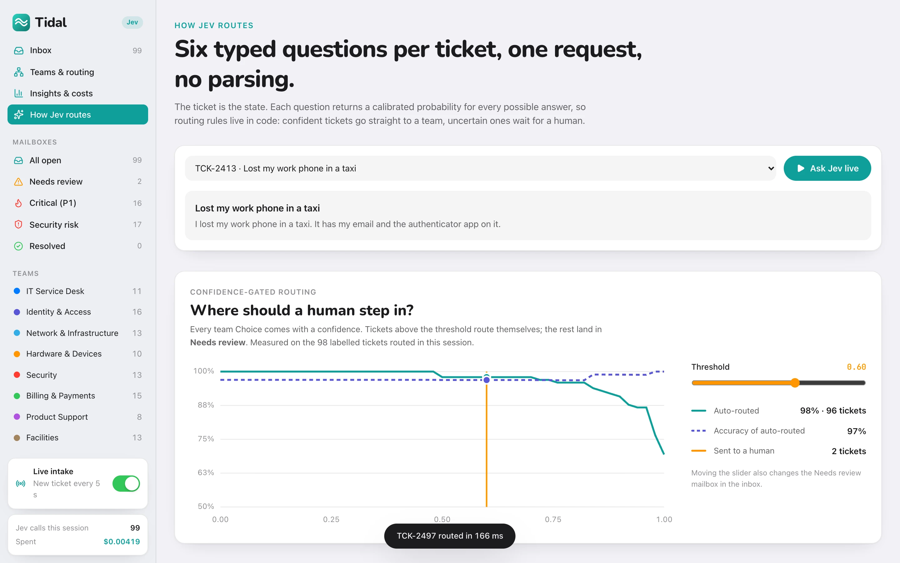
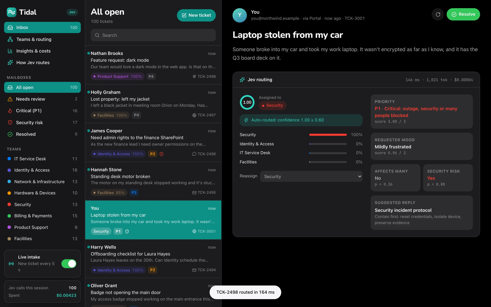

<!-- hero -->
<div align="center">

# Tidal

**IT & support ticket routing with Jev**

IT and support ticket routing. One Jev request per ticket picks the team, priority, mood and risk, with probabilities that decide when a human should step in.

    -7c3aed)



<sub>Inbox with live intake: every ticket routed the moment it lands</sub>

</div>

## Screenshots

| | |
|---|---|
|  |  |
| <sub>A stolen laptop routes itself to Security as P1</sub> | <sub>Your org chart is the routing rule</sub> |
|  |  |
| <sub>Insights and costs: every token in the open</sub> | <sub>Confidence-gated routing: where should a human step in?</sub> |
|  | |
| <sub>Dark mode</sub> | |

## About

An open-source showcase of **TypeSafe's Jev** as a ticket router. Every ticket is classified in one request: which team
should own it (with a probability for every team), priority, requester mood, whether it affects many people, whether it's
a security risk, and which saved reply to start from. Because Jev returns calibrated probabilities instead of generated
text, routing rules live in plain code: confident tickets route themselves, uncertain ones wait for a human.

Built with Next.js 16, React 19, Tailwind v4 and Framer Motion, following Apple's Human Interface Guidelines (SF Pro /
SF Pro Rounded, grouped backgrounds, translucent sidebar, light and dark mode) with a teal accent.

## Run it

```bash
npm install
cp .env.example .env.local   # add your TYPESAFE_API_KEY
npm run dev                  # http://localhost:3000
```

## What to try

1. **Inbox**: 118 synthetic IT and customer-support tickets routed on load (≈1–2 s, ≈$0.005 for all six questions on every
   ticket). Mailboxes for *Needs review* (low confidence), *Critical (P1)* and *Security risk*.
2. **Live intake**: flip the switch in the sidebar; a new ticket lands and is routed every 5 seconds. Or write your own
   with **New ticket**.
3. **Teams & routing**: take a team offline, merge Network + Hardware, split Product Support, or add a Developer Platform
   team, then **Re-route** the whole backlog with one click. Only the team question is re-asked (≈1 s, ≈$0.002), and a
   flow diagram shows exactly which tickets moved where.
4. **Insights & costs**: cost to triage 1,000 tickets and time per ticket for Jev (measured) vs hosted LLMs (estimated from
   token counts and list prices), a labelled-ticket benchmark (Jev: ~97% team accuracy), and a log of every Jev call.
5. **How Jev routes**: the exact request and typed answers for any ticket, plus a confidence-threshold slider that shows
   how much gets automated and how accurate that slice is.

## Comparing with a local Apple MLX model

Tidal can benchmark a local model served by [`mlx-lm`](https://github.com/ml-explore/mlx-lm) on Apple silicon:

```bash
pip install mlx-lm
mlx_lm.server --model mlx-community/Llama-3.2-3B-Instruct-4bit --port 8080
```

Then add to `.env.local`:

```
MLX_BASE_URL=http://127.0.0.1:8080
MLX_MODEL=mlx-community/Llama-3.2-3B-Instruct-4bit
```

and press **Run local MLX** on the Insights page. The local model is asked for a team name in plain text, and its answer is
mapped back to a team.

## Code map

- `src/lib/questions.ts`: the six typed questions; teams are built from the editable department list
- `src/lib/router.ts`: Jev calls, 24 in flight, streamed to the browser as NDJSON
- `src/lib/mlx.ts`: optional OpenAI-compatible client for `mlx_lm.server`
- `src/lib/data.ts`: teams, restructure scenarios, reply macros and the labelled synthetic tickets
